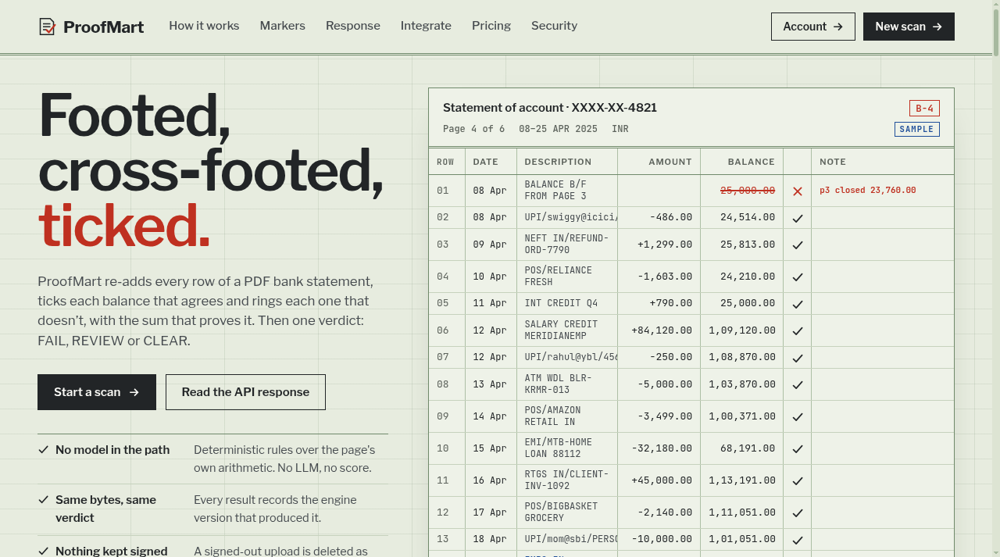
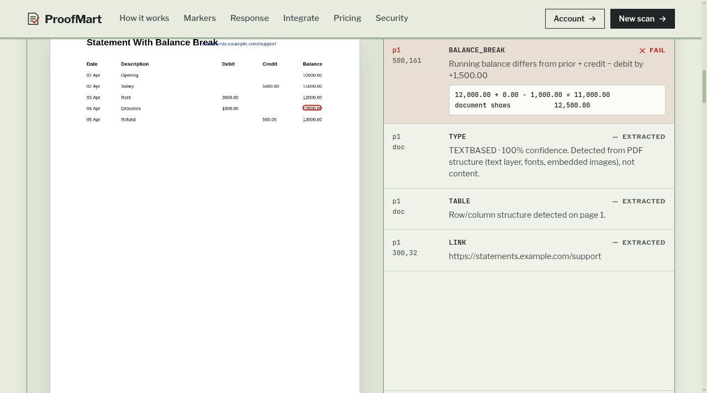
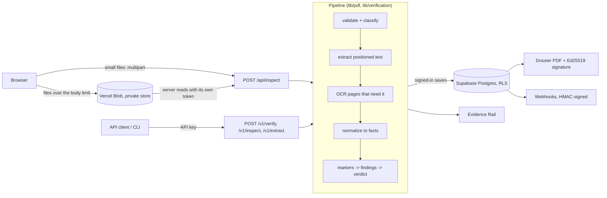

# ProofMart

Re-adds every row of a PDF bank statement and shows the arithmetic: each balance that agrees gets a tick, each one that doesn't gets a ring, with the sum that proves it. Built for people who check statements before relying on them.

[Live demo](https://proofmart.shop/) | [App and API docs](web/README.md) | [Launch checklist](LAUNCH.md) | [Report an issue](https://github.com/latharrr/Proofmart.shop/issues)


| At a glance | |
|---|---|
| **Status** | Live beta at proofmart.shop. Live payments have not run yet (see Known limitations) |
| **Stack** | Next.js 16, TypeScript, Supabase (Postgres + RLS + Auth), Vercel Blob, Tesseract.js OCR |
| **Method** | Fixed arithmetic rules over the statement's own numbers. No AI model in the verdict path |
| **Tests** | 215 unit tests (197 pass, 7 OCR tests need a fixed Chromium path, 11 skipped); CI runs type-check, lint, tests, build |
| **Scope** | Web app, PDF parsing pipeline, public API, CLI, auth and storage |

## Why this exists

Checking a statement by hand means re-adding columns and hunting for duplicate or out-of-order rows. ProofMart does that with fixed rules over the page's own numbers. There is no AI model and no score in the path. The same bytes give the same verdict, and every result records the engine version that made it.

A verdict is a statement about internal consistency, not about authenticity. A CLEAR result means the markers that ran found nothing. It does not certify that the document was issued by the party it names or that every kind of tampering was checked for. The signed dossier says this on its Limitations page.

## Product demo

The landing page re-foots a built-in sample statement, so you can see the idea without uploading anything.



Upload a PDF and the Evidence Rail lists findings next to the page. Each finding is pinned to coordinates on the page. The screenshot below is a synthetic 5-row statement (generated by this repo's own test fixtures, no real data) where a running balance is 1,500.00 too high:



## Try the demo

1. Open https://proofmart.shop/ and choose "Start a scan".
2. Drop any PDF. No account is needed. A signed-out upload is deleted when its scan finishes.
3. To reproduce the screenshot above, generate the synthetic statement with the test fixtures:
   `cd web && npm ci`, then call `arithmeticInconsistencyPdf()` from `tests/fixtures/build.ts`.

The demo uses sample data and does not expose real user information. No shared demo account is published. Create your own account to save results.

## Key features

- Six deterministic markers: `BALANCE_BREAK`, `CROSS_PAGE_TOTAL_MISMATCH` (FAIL on hit); `DATE_SEQUENCE_ANOMALY`, `DUPLICATE_TRANSACTION`, `OCR_LOW_CONFIDENCE`, `ENCODING_ANOMALY` (REVIEW on hit).
- Fixed verdict order: `INCONCLUSIVE` (no marker had enough evidence to run), `FAIL`, `REVIEW`, `CLEAR`. When a marker lacks the columns it needs, it reports "insufficient data" instead of guessing.
- Evidence Rail: every finding carries its page and coordinates.
- OCR with Tesseract.js, only on pages that need it.
- Signed-in users get results saved and retrievable on the web and over the API.
- Signed PDF dossier per saved result. Signatures are checkable at `/v1/verify-signature`.
- Public API (`/v1/inspect`, `/v1/extract`, `/v1/verify`, `/v1/documents`), hashed API keys, HMAC-signed webhooks, and a CLI.

## Architecture

All of these run the same pipeline: the web upload, the `/v1` API, webhooks and the CLI.



Details of each stage, the marker registry and the environment variables are in [`web/README.md`](web/README.md). Database migrations are in `web/supabase/migrations` (documents, API keys, webhooks, billing, signatures, audit events, rate limits).

## Technical highlights

- **No model in the verdict path.** Rules over extracted arithmetic. Markers that would need evidence the pipeline does not have (`PRODUCER_MISMATCH`, `FONT_METRIC_SHIFT`, column inconsistency) are documented in `registry.ts` as deliberately not built.
- **Evidence you can point at.** Each finding keeps its page, coordinates and the exact sum, for example `12,000.00 + 0.00 - 1,000.00 = 11,000.00` against `document shows 12,500.00`.
- **Pinned native dependency.** `@firecrawl/pdf-inspector` is held at 1.12.0 because 1.13.0+ needs a newer glibc than Vercel's runtime has. The reason and consequences are in `web/README.md`.
- **Dossier fonts.** The dossier PDF embeds Libre Franklin and JetBrains Mono. Characters outside the fonts print as "?" and the dossier says how many were replaced. The signed payload keeps the original text.

## Security and privacy

- **Auth:** Supabase Auth (email + password, Google). Access to saved data is enforced by row-level security, with cross-tenant tests in `web/tests/unit/rls-cross-tenant.test.ts`.
- **API keys:** shown once; only a SHA-256 hash and a display prefix are stored. Revoking keeps the row.
- **Uploads:** PDF header check, filename sanitising, 20 MiB limit, trusted-Blob-URL check. The Blob store must be private.
- **Retention:** a signed-out upload is deleted after its scan. For signed-in users the PDF stays in private storage until the user deletes the document, which removes the database row and the file together. Rate-limit counters are pruned after 1 day, webhook delivery history after 90 days, audit events after 180 days.
- **Abuse limits:** a per-minute limit on every `/v1` route plus a monthly plan quota, both covered by unit tests.
- **Signatures:** dossier signatures use Ed25519 and are verifiable without an account.

## Testing

```bash
cd web
npm ci
npm run test:unit
npx tsc --noEmit
npm run lint
npm run build
```

Measured on 25 Oct 2026: 215 unit tests, 197 passed, 7 failed, 11 skipped. The 7 failures are the OCR tests that launch a Chromium at a hardcoded sandbox path; they fail the same way on the unchanged code and are excluded in CI, so they are not counted as passes. Type-check, lint and build were clean. The dossier regression test renders all six markers' real text, including `₹ − ≈ ≠` and a non-Latin filename, and runs in CI.

CI (`.github/workflows/ci.yml`) runs type-check, lint, unit tests (OCR tests excluded) and build on every push.

### Measured processing time

Time for the whole `runVerify` function (validate, classify, extract text, normalize, run markers, build the verdict) on this repo's synthetic one- and two-page text PDFs (1.6 to 1.9 KB), 7 runs each, on 25 Oct 2026 in a 1-vCPU, 2 GB Linux sandbox. OCR did not run (these PDFs have a text layer). Upload, network, database and dossier generation are not included:

| Synthetic input | Verdict | Warm median | Slowest of 7 |
|---|---|---|---|
| clean statement | CLEAR | 3 ms | 6 ms |
| balance break | FAIL (`BALANCE_BREAK`) | 2 ms | 7 ms |
| duplicate transaction | REVIEW (`DUPLICATE_TRANSACTION`) | 1 ms | 4 ms |
| date sequence anomaly | REVIEW (`DATE_SEQUENCE_ANOMALY`) | 1 ms | 3 ms |
| cross-page total mismatch (2 pages) | FAIL (`CROSS_PAGE_TOTAL_MISMATCH`) | 2 ms | 3 ms |
| table without a balance column | CLEAR, `BALANCE_BREAK` skipped for insufficient data | 2 ms | 3 ms |

These are tiny text PDFs. They are not the latency a user sees, and say nothing about real statements, scanned pages, OCR time, upload or network time, or accuracy. None of those have been measured.

## Deployment

Next.js 16 on Vercel (Node.js runtime, because the PDF library is a native module), Supabase for auth and data, Vercel Blob for uploads. A push to `main` deploys production through the linked Vercel project. Setup steps and the settings that caused real outages are in the Deploying section of [`web/README.md`](web/README.md).

## Known limitations

- Live payments have never run against a real Razorpay account. Checkout returns 503 until it is configured, and plan prices are placeholders.
- The legal pages (`/privacy`, `/terms`, `/refunds`, `/contact`) still contain business-name placeholders.
- Supabase's built-in email sender is for testing and rate-limits aggressively. Production needs custom SMTP.
- Test-account credentials from early development remain in public git history. Remediation is pending, so treat them as exposed and do not rely on them.
- The two OCR unit tests need a Chromium at a fixed path and fail elsewhere (see Testing).
- OCR quality and accuracy on real-world scans have not been measured.
- Verdicts check internal consistency only, never authenticity of the issuer.

## Roadmap

Next, in order: configure live billing and test one real payment; finish the legal pages; set up production SMTP; make the OCR tests use a Playwright-installed browser so CI can run them; measure processing time and OCR behaviour on a set of real, consented scans; add `npm audit` to CI.

## Repo layout and local setup

The app lives in [`web/`](web/); setup, environment variables, auth, the API and Vercel deployment are in [`web/README.md`](web/README.md). `cli/` holds the command-line client. [`DESIGN.md`](DESIGN.md) records the visual system and [`PRODUCT.md`](PRODUCT.md) the product context. `design-system*.md` and `bar*.md` describe retired directions and are kept for history. `chats/` and `project/` hold the original design handoff files.

```bash
cd web
npm install
npm run dev
```

Open http://localhost:3000. Uploading a PDF works locally with no environment variables. Sign-in needs the Supabase variables listed in `web/.env.example`.

## Author

Deepanshu Lathar - https://deepanshulathar.com - [@latharrr](https://github.com/latharrr)
